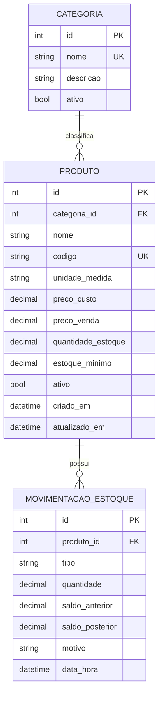

# MercadoGestor — Modelagem v0.1 (Categoria, Produto, Movimentação de Estoque)

> Salve este arquivo em `docs/01-modelagem.md` do repositório.

## 1. Modelo conceitual (MER)

Situação real: no mercadinho, o "Leite Integral 1L" fica na categoria "Laticínios". Toda vez que chega mercadoria, algo é vendido ou o dono corrige uma contagem, isso precisa ficar registrado.

Entidades e relacionamentos:

- **Categoria** 1 —— N **Produto**: uma categoria tem vários produtos; cada produto pertence a exatamente uma categoria.
- **Produto** 1 —— N **Movimentação de Estoque**: um produto tem várias movimentações; cada movimentação refere-se a um único produto.

Notação: `||` = exatamente um; `o{` = zero ou muitos.

## 2. Dicionário de dados

### Categoria
| Campo | Tipo | Restrições | Descrição |
|---|---|---|---|
| id | Integer | PK | Identificador |
| nome | String(80) | NOT NULL, UNIQUE | Ex.: "Laticínios" |
| descricao | String(255) | opcional | Detalhes |
| ativo | Boolean | NOT NULL, default true | Desativação em vez de exclusão |

### Produto
| Campo | Tipo | Restrições | Descrição |
|---|---|---|---|
| id | Integer | PK | Identificador |
| categoria_id | Integer | FK → categoria.id, NOT NULL | Categoria do produto |
| nome | String(120) | NOT NULL | Ex.: "Arroz Tipo 1 5kg" |
| codigo | String(50) | NOT NULL, UNIQUE | Código interno ou de barras |
| unidade_medida | String(10) | NOT NULL | UN, KG, L, CX... |
| preco_custo | Numeric(10,2) | NOT NULL, ≥ 0 | Quanto o mercado paga |
| preco_venda | Numeric(10,2) | NOT NULL, ≥ 0 | Quanto o cliente paga |
| quantidade_estoque | Numeric(10,3) | NOT NULL, ≥ 0 | Saldo atual |
| estoque_minimo | Numeric(10,3) | NOT NULL, ≥ 0 | Limite para alerta |
| ativo | Boolean | NOT NULL, default true | Status |
| criado_em / atualizado_em | DateTime | NOT NULL | Auditoria básica |

### MovimentacaoEstoque
| Campo | Tipo | Restrições | Descrição |
|---|---|---|---|
| id | Integer | PK | Identificador |
| produto_id | Integer | FK → produto.id, NOT NULL | Produto movimentado |
| tipo | String(10) | NOT NULL, ENTRADA / SAIDA / AJUSTE | Natureza |
| quantidade | Numeric(10,3) | NOT NULL, > 0 | Quantidade movimentada (sempre positiva) |
| saldo_anterior | Numeric(10,3) | NOT NULL | Saldo antes |
| saldo_posterior | Numeric(10,3) | NOT NULL, ≥ 0 | Saldo depois |
| motivo | String(255) | NOT NULL | Ex.: "Compra", "Produto vencido" |
| data_hora | DateTime | NOT NULL | Quando ocorreu |

(`usuario_id` entra na Fase 8, quando existir autenticação.)

## 3. Decisões de modelagem e justificativas

1. **Desativar em vez de excluir (`ativo`)**: se um produto já teve movimentações ou vendas, apagá-lo quebraria o histórico (integridade referencial). Desativar preserva tudo.
2. **Saldo guardado no produto *e* histórico de movimentações**: o saldo em `produto` torna a consulta rápida (PDV). O histórico garante rastreabilidade. É uma redundância intencional (desnormalização controlada); a consistência é garantida pela camada de *service*, dentro de uma **transação**: ou grava a movimentação e atualiza o saldo, ou não grava nada.
3. **`saldo_anterior` e `saldo_posterior` na movimentação**: permitem auditar e detectar divergências ("o saldo não bate com o histórico?").
4. **`quantidade` sempre positiva e `tipo` define o sinal**: evita ambiguidade e facilita a validação "quantidade > 0". Em AJUSTE, o saldo anterior/posterior mostra o efeito real.
5. **Dinheiro e quantidades com `Numeric`/`Decimal`, nunca `float`**: `0.1 + 0.2` em float dá `0.30000000000000004`. Em dinheiro, isso vira centavos errados. Quantidade com 3 casas permite vender 0,350 kg de tomate. Observação: o SQLite não tem tipo decimal nativo; o SQLAlchemy avisa e converte. Para o projeto inicial, trabalhamos com `Decimal` no Python e arredondamos no service. (Alternativa futura: guardar centavos como inteiro.)
6. **Normalização (3FN)**: o nome da categoria existe em um único lugar (tabela `categoria`); o produto guarda só a chave estrangeira.

## 4. Regras de negócio desta etapa

- RN01: nome da categoria é único.
- RN02: código do produto é único.
- RN03: preços e estoque mínimo não podem ser negativos.
- RN04: o saldo nunca pode ficar negativo.
- RN05: toda alteração de saldo gera uma movimentação com motivo.
- RN06: uma saída maior que o saldo disponível é bloqueada.
- RN07: produto com `quantidade_estoque <= estoque_minimo` aparece no alerta de estoque baixo.
- RN08: categorias e produtos são desativados, não excluídos.
- RN09: não é possível desativar uma categoria que ainda tem produtos ativos.
- RN10: só se cadastra ou move produto para categoria ativa; não se reativa produto cuja categoria está inativa.
- RN11: a unidade de medida não pode ser alterada se o produto já tem estoque ou histórico de movimentações.
- RN12: o saldo de estoque não é editado no cadastro do produto. Começa em 0 e só muda por movimentações (Fase 4).
- RN13: preço de venda abaixo do custo (ou zerado) é permitido, mas gera um aviso ao dono.

### Convenções de dados
- Dinheiro: `Decimal`, 2 casas (máx. 99.999.999,99). Quantidades: `Decimal`, 3 casas.
- Entrada de números no padrão brasileiro (`4,50` ou `1.234,56`). Valores com mais casas decimais que o permitido são recusados, nunca arredondados em silêncio. `NaN`, `Infinity` e notação científica (`1e5`) são recusados.
