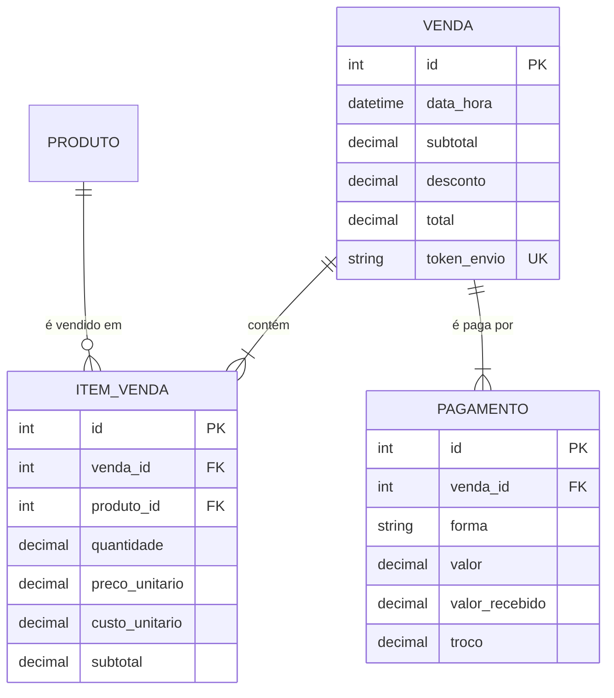

# MercadoGestor — Vendas e PDV (v0.7)

Continuação de `01-modelagem.md`. As regras seguem a numeração do projeto (RN19 em diante).

## 1. O que o PDV faz

O caixa monta o carrinho (por código ou busca pelo nome), aplica um desconto controlado, escolhe a forma de pagamento e finaliza. O sistema calcula o total e o troco, grava a venda, baixa o estoque e mostra um comprovante.

Exemplo de mercado: o cliente leva 2 leites (R$ 6,99) e 0,350 kg de tomate (R$ 8,90/kg), ganha 10% de desconto e paga com R$ 20,00.

| Item | Cálculo | Resultado |
|---|---|---|
| Leite | 2 × 6,99 | R$ 13,98 |
| Tomate | 0,350 × 8,90 = 3,115 → arredonda ao centavo | R$ 3,12 |
| Subtotal | 13,98 + 3,12 | R$ 17,10 |
| Desconto 10% | 1,710 → truncado para baixo | R$ 1,71 |
| **Total** | 17,10 − 1,71 | **R$ 15,39** |
| Troco | 20,00 − 15,39 | R$ 4,61 |

## 2. Modelo de dados



### Dicionário de dados

**Venda** (`venda`)
| Campo | Tipo | Restrições |
|---|---|---|
| id | Integer | PK |
| data_hora | DateTime (UTC) | NOT NULL, automática |
| subtotal | Numeric(10,2) | NOT NULL, ≥ 0 |
| desconto | Numeric(10,2) | NOT NULL, ≥ 0 e ≤ subtotal |
| total | Numeric(10,2) | NOT NULL, ≥ 0 e ≤ subtotal |
| token_envio | String(36) | UNIQUE (evita venda duplicada) |

**ItemVenda** (`item_venda`): UNIQUE (venda_id, produto_id)
| Campo | Tipo | Restrições |
|---|---|---|
| venda_id | Integer | FK → venda.id, NOT NULL |
| produto_id | Integer | FK → produto.id, NOT NULL |
| quantidade | Numeric(10,3) | NOT NULL, > 0 |
| preco_unitario | Numeric(10,2) | NOT NULL, ≥ 0 (**cópia** do preço no momento) |
| custo_unitario | Numeric(10,2) | NOT NULL, ≥ 0 (**cópia** do custo no momento) |
| subtotal | Numeric(10,2) | NOT NULL, ≥ 0 |

**Pagamento** (`pagamento`)
| Campo | Tipo | Restrições |
|---|---|---|
| venda_id | Integer | FK → venda.id, NOT NULL |
| forma | String(10) | DINHEIRO, PIX, DEBITO ou CREDITO |
| valor | Numeric(10,2) | NOT NULL, > 0 (quanto abate da venda) |
| valor_recebido | Numeric(10,2) | só dinheiro |
| troco | Numeric(10,2) | NOT NULL, ≥ 0 |

### Decisões de modelagem

1. **O item copia preço e custo do produto.** Se o leite subir de preço amanhã, o comprovante de hoje continua mostrando o que foi realmente cobrado. O custo copiado permite calcular o lucro bruto de cada venda nos relatórios (Fase 7).
2. **Pagamento em tabela própria (1—N)**, mesmo hoje havendo um só por venda. Pagar metade em dinheiro e metade no Pix passa a ser possível sem mudar o banco.
3. **Um produto aparece uma única vez por venda** (UNIQUE). Adicionar o mesmo produto de novo soma a quantidade.

## 3. Regras de negócio

| Regra | Descrição |
|---|---|
| RN19 | A venda precisa de ao menos um item. As quantidades seguem as regras de estoque (RN14, RN15). |
| RN20 | Preço e custo do item são copiados do produto no momento da venda. |
| RN21 | Subtotal do item = preço × quantidade, arredondado ao centavo (meio para cima). |
| RN22 | O desconto é sobre o total da venda e limitado a um percentual máximo (padrão 10%). Desconto em % é truncado para baixo no centavo: nunca passa do % digitado. |
| RN23 | O total da venda precisa ser maior que zero. |
| RN24 | Dinheiro: valor recebido ≥ total (em branco = valor exato) e troco = recebido − total. Pix e cartões cobram exatamente o total. |
| RN25 | Finalizar é **atômico**: venda, itens, pagamento e baixas de estoque (motivo "Venda #N") valem juntos ou não valem nada. |
| RN26 | Venda concluída não é editada nem excluída. Estorno e cancelamento de venda concluída ficam para uma fase futura. |
| RN27 | O mesmo envio de formulário não gera duas vendas (token de envio único). |
| RN28 | O carrinho guarda só `{produto: quantidade}`. **Preços nunca vêm do navegador**: são lidos do banco a cada tela e na finalização. |
| RN29 | Reenviar o formulário de uma venda já registrada (clique duplo, botão "voltar") leva ao comprovante da venda original, sem vender de novo. |
| RN30 | Um desconto guardado que deixa de valer (ex.: o carrinho diminuiu e passou do limite) é removido com aviso. |

O limite de desconto é configurável pela variável de ambiente `DESCONTO_MAXIMO_PERCENTUAL` (padrão `10`). Quando existirem perfis de usuário (Fase 8), o administrador poderá ter um limite próprio.

## 4. Como a finalização funciona (RN25)

```
1. Confere o carrinho de novo (saldo, produto ativo, desconto, pagamento)
2. Cria a Venda e gera o número              (ainda sem confirmar)
3. Para cada item: grava ItemVenda + baixa o estoque (movimentação "Venda #N")
4. Grava o Pagamento
5. COMMIT único  → tudo vale
   qualquer erro → ROLLBACK → nada vale (inclusive as baixas já feitas)
```

Exemplo: o cliente leva 2 leites e 5 arroz, mas só há 3 arroz. O leite é baixado no passo 3 **antes** de o arroz falhar. O rollback desfaz também o leite, e o estoque e o histórico continuam consistentes. Por isso a baixa de estoque da venda usa `confirmar=False`: ela envia ao banco (`flush`) sem confirmar, e só o `commit` final da venda confirma.

## 5. Segurança e integridade do PDV

- **Preço não vem do navegador (RN28):** mesmo que alguém envie campos como `preco` ou `total` à mão, eles são ignorados.
- **CSRF:** todas as ações do PDV são POST e exigem token. Teste automatizado confere cada rota.
- **Token de envio (RN27, RN29):** cada venda em andamento tem um UUID. Se o mesmo formulário chegar duas vezes, a segunda vai ao comprovante da primeira. A restrição UNIQUE no banco é a última barreira.
- **Concorrência:** a baixa de estoque só vale se o saldo no banco ainda for o que foi lido (veja `estoque_service._registrar`).

## 6. Telas

| Tela | Endereço | Função |
|---|---|---|
| PDV (caixa) | `/pdv/` | Busca, carrinho, desconto, pagamento e finalização |
| Comprovante | `/pdv/vendas/<n>` | Itens, descontos, pagamento e troco; imprimível; "não é documento fiscal" |
| Vendas | `/pdv/vendas` | Lista por período (padrão: hoje, no horário do mercado) com total |

O troco mostrado na tela enquanto o caixa digita é só uma prévia em JavaScript. O valor oficial é calculado e conferido pelo servidor.

## 7. Limitações conhecidas (próximas fases)

- Sem estorno ou cancelamento de venda concluída (RN26).
- Um único pagamento por venda (o banco já comporta vários).
- Sem identificação do operador de caixa (Fase 8) e sem cliente.
- O comprovante não é nota fiscal (integrações fiscais estão fora do escopo inicial).
- A lista de vendas mostra no máximo as 200 mais recentes do período.
- Os testes cobrem o servidor; o JavaScript (prévia do troco, confirmações) ainda não tem testes automatizados.
